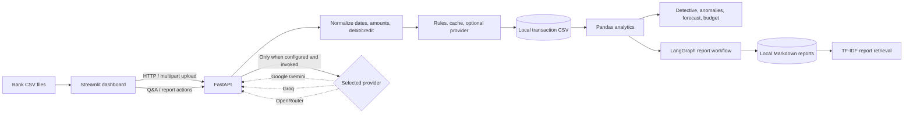
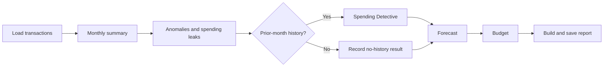

<div align="center">

# SpendSense

### Your personal-finance analyst: understand spending, spot unusual activity, and plan what comes next.

Upload bank CSVs to get categorized transactions, spending explanations, anomaly detection, forecasts, budgets, AI Q&A, and monthly reports—all from one local-first app.

[](https://www.python.org/)
[](https://fastapi.tiangolo.com/)
[](https://streamlit.io/)
[](https://langchain-ai.github.io/langgraph/)
[](#llm-providers)
[](.github/workflows/ci.yml)
[](LICENSE)

</div>

---

## Contents

- [Overview](#overview)
- [Highlights](#highlights)
- [How it works](#how-it-works)
- [Quick start](#quick-start)
- [LLM providers](#llm-providers)
- [Dashboard tour](#dashboard-tour)
- [Bank CSV format](#bank-csv-format)
- [REST API](#rest-api)
- [Docker](#docker)
- [Project layout](#project-layout)
- [Testing and CI](#testing-and-ci)
- [Privacy and security](#privacy-and-security)
- [Limitations](#limitations)
- [Contributing](#contributing)
- [License](#license)

## Overview

SpendSense is a single-user personal-finance analysis project built with Python as an M.Tech Data Science capstone. Import monthly bank statements and explore your finances in a Streamlit dashboard backed by a FastAPI service.

**Design principle:** pandas computes the financial metrics; an optional language model helps explain them. The application remains usable in rule-based offline mode when no provider key is configured.

> **Project status:** built as a local, educational project—not a bank connection or a production multi-user financial service.

## Highlights

| Area | What SpendSense does |
|---|---|
| CSV import | Normalizes common bank exports, extracts merchants, and deduplicates repeat uploads. |
| Categories | Applies ordered merchant rules, optional AI fallback for unknown merchants, and persistent user corrections. |
| Monthly overview | Shows income, spending, savings rate, investments, category breakdowns, and top merchants. |
| Spending Detective | Compares a month with up to three prior months and decomposes category changes into transaction-frequency and average-ticket effects. |
| Anomalies and waste | Uses median/MAD outlier checks, first-seen merchant and duplicate-charge heuristics, plus rule-based spending suggestions. |
| Forecast | Blends an outlier-damped weighted moving average with a linear trend; reports an approximate 80% interval and rolling-origin backtest MAPE when enough history exists. |
| Budget | Protects essential categories with a buffer and estimates category caps for a savings target. |
| Ask AI | Answers questions using computed facts and, when available, retrieved report sections. |
| Reports and RAG | Runs a LangGraph report workflow and searches saved report sections with local TF-IDF similarity. |
| Local-first | Stores transactions and reports in the configured data directory; API and dashboard bind to localhost by default in Docker Compose. |

## How it works



The report workflow is:



## Quick start

### 1. Create a Python environment

From the project directory in **Windows PowerShell**:

```powershell
python -m venv .venv
.\.venv\Scripts\Activate.ps1
python -m pip install -r requirements.txt
```

If PowerShell prevents environment activation, you can invoke the environment's Python directly:

```powershell
.\.venv\Scripts\python.exe -m pip install -r requirements.txt
```

### 2. Configure the app

Create `.env` from the example only if you do not already have a `.env`:

```powershell
if (-not (Test-Path .env)) { Copy-Item .env.example .env }
```

Edit `.env` on your computer. Keep provider keys private. For rule-based offline mode, leave all provider keys empty. See [LLM providers](#llm-providers) for provider selection and model names.

### 3. Load demo data

```powershell
python scripts/generate_sample_data.py
```

The generator creates sample statements under `data/sample/`. They are synthetic demonstration data; use them to explore the app before importing personal statements.

### 4. Run tests

```powershell
python -m pytest -q
```

### 5. Start the API and dashboard

Open two terminals in the project folder.

**Terminal 1 — FastAPI:**

```powershell
python -m uvicorn app.api:app --reload --host 127.0.0.1 --port 8000
```

- Interactive API docs: <http://127.0.0.1:8000/docs>
- OpenAPI schema: <http://127.0.0.1:8000/openapi.json>
- Health check: <http://127.0.0.1:8000/health>

**Terminal 2 — Streamlit:**

```powershell
$env:SPENDSENSE_API_URL = "http://127.0.0.1:8000"
python -m streamlit run dashboard/streamlit_app.py --server.address 127.0.0.1 --server.port 8501
```

Open <http://127.0.0.1:8501>. Stop either service with **Ctrl+C** in its terminal.

### macOS/Linux activation

The commands above use PowerShell syntax. On macOS or Linux, activate the environment with:

```bash
source .venv/bin/activate
```

The `python -m uvicorn` and `python -m streamlit` commands are otherwise the same; omit the PowerShell `$env:SPENDSENSE_API_URL` line unless you want to override the default API URL.

## LLM providers

Set `LLM_PROVIDER` to exactly one provider. SpendSense uses only that provider's key; keys for the other providers are ignored. Supported values:

| `LLM_PROVIDER` | Environment variable | Example model |
|---|---|---|
| `google` | `GOOGLE_API_KEY` | `gemini-2.5-flash` |
| `groq` | `GROQ_API_KEY` | `llama-3.3-70b-versatile` |
| `openrouter` | `OPENROUTER_API_KEY` | `google/gemini-2.5-flash` |
| `auto` | First configured key in Google → Groq → OpenRouter order | Must match the selected provider |

`LLM_MODEL` must be a model available through the selected provider. OpenRouter uses its OpenAI-compatible API endpoint; configure `OPENROUTER_API_KEY` and an OpenRouter model ID. An OpenAI API key/provider is not required.

The `.env.example` file contains empty placeholders, not real credentials. `.env` is ignored by Git. Never paste keys into source files, commits, screenshots, issue reports, or chat messages. If a key is exposed, revoke it with its provider and replace it.

## Dashboard tour

The seven tabs cover:

1. **Overview** — monthly KPIs, category chart, history, and top merchants.
2. **Spending Detective** — what changed, the biggest category drivers, and frequency-versus-ticket effects.
3. **Unusual & Waste** — flagged transactions, duplicate candidates, and rule-based saving opportunities.
4. **Forecast & Budget** — next-month estimate, uncertainty range, backtest result, and adjustable savings target.
5. **Ask AI** — suggested questions and grounded answers with retrieved report references when available.
6. **Reports (RAG)** — generate a LangGraph report, search previous reports, and download Markdown.
7. **Transactions** — browse a month and save remembered merchant-category corrections.

Upload CSV files, load synthetic demo statements, or clear the local transaction store from the sidebar.

## Bank CSV format

The CSV parser recognizes case-insensitive common headers:

| Field | Examples |
|---|---|
| Date | `Date`, `Txn Date`, `Transaction Date`, `Value Date`, `Posting Date` |
| Description | `Description`, `Narration`, `Particulars`, `Details`, `Remarks` |
| Debit and credit | `Debit` + `Credit`, `Withdrawal` + `Deposit`, or similar supported variants |
| Signed amount | `Amount` or `Transaction Amount`; negative is treated as spending and positive as income unless a transaction-type column indicates otherwise |
| Transaction type (optional) | `Type`, `Dr/Cr`, `Transaction Type` |

Rows without a valid date or positive amount are discarded. The normalized transaction store is `data/store/transactions.csv` by default; set `SPENDSENSE_DATA` to use another directory. Re-uploading the same statement is deduplicated.

## REST API

FastAPI docs at `/docs` provide request schemas and a “Try it out” interface. The API listens locally when started with the Quick start command.

| Method | Path | Purpose |
|---|---|---|
| `GET` | `/health` | Service and selected-provider status |
| `POST` | `/upload` | Ingest CSV files as multipart form data (`files`) |
| `POST` | `/demo-data` | Ingest the bundled sample CSVs |
| `DELETE` | `/data` | Clear the transaction store |
| `GET` | `/months` | List available transaction months |
| `GET` | `/transactions?month=YYYY-MM` | Read transactions, optionally filtered by month |
| `GET` | `/categories` | List transaction categories |
| `PUT` | `/categories` | Save merchant category overrides |
| `GET` | `/summary/{month}` | Monthly totals and breakdown |
| `GET` | `/anomalies/{month}` | Anomalies and unnecessary-spend rules |
| `GET` | `/detective/{month}` | Explain changes against history |
| `POST` | `/detective/{month}/narrate` | Generate an optional provider narration |
| `GET` | `/forecast?month=YYYY-MM` | Forecast after the selected month |
| `GET` | `/budget?savings_target=0.2&month=YYYY-MM` | Personalized budget |
| `POST` | `/report/{month}` | Run and save a monthly report |
| `GET` | `/reports` | List saved report months |
| `GET` | `/reports/search?q=...&limit=4` | Search report sections |
| `GET` | `/reports/{month}` | Get a saved Markdown report |
| `POST` | `/ask` | Ask a question with `{"question":"..."}` |

Example category override body:

```json
{
  "overrides": {
    "Example Merchant": "Groceries"
  }
}
```

`DELETE /data` is destructive for the configured local transaction store. It does not delete sample CSVs or reports.

## Docker

Docker Compose starts FastAPI and Streamlit together, shares the data volume, waits for the API health check, and publishes both services on localhost only:

```powershell
docker compose up --build
```

- Dashboard: <http://127.0.0.1:8501>
- API docs: <http://127.0.0.1:8000/docs>

Stop with **Ctrl+C**. To remove the Compose-managed data volume as well, use `docker compose down --volumes`; this deletes stored transaction data and reports.

## Project layout

```text
spendsense/
├── app/
│   ├── analysis.py       summaries, anomaly checks, and spend-leak rules
│   ├── api.py            FastAPI routes
│   ├── budget.py         savings-target budget suggestions
│   ├── categorizer.py    merchant rules, provider fallback, and overrides
│   ├── config.py         local data paths and category definitions
│   ├── detective.py      frequency/ticket decomposition
│   ├── forecast.py       forecast and rolling-origin backtest
│   ├── graph.py          LangGraph report workflow
│   ├── llm_client.py     Google, Groq, OpenRouter, and offline selection
│   ├── loader.py         bank CSV normalization
│   ├── qa.py             fact-grounded question answering
│   ├── rag.py            local TF-IDF report retrieval
│   ├── report.py         Markdown report builder
│   └── store.py          deduplication and transaction persistence
├── dashboard/
│   ├── api_client.py     HTTP client for the local API
│   └── streamlit_app.py  seven-tab dashboard
├── data/
│   ├── sample/           synthetic example statements
│   ├── reports/          generated Markdown reports
│   └── store/            local transaction data
├── scripts/
│   ├── demo.py
│   └── generate_sample_data.py
├── tests/
├── .env.example
├── Dockerfile
├── docker-compose.yml
├── LICENSE
├── Makefile
└── requirements.txt
```

## Testing and CI

Run the test suite locally:

```powershell
python -m pytest -q
```

GitHub Actions is configured in `.github/workflows/ci.yml` to install dependencies, generate sample data, run tests on pushes and pull requests, then build the Docker image.

## Privacy and security

- The application has no bank-feed integration; statements are uploaded by the user.
- Local mode stores data on the machine and uses deterministic analysis without calling an LLM.
- When enabled, provider calls may include merchant names, transaction descriptions, computed financial facts, or retrieved report excerpts needed by the selected feature. Check your provider's terms and avoid using sensitive real statements unless you accept that transfer.
- The default development commands bind services to `127.0.0.1`. Do not expose this unauthenticated single-user API to a public network.
- Keep `.env` private; use `.env.example` as the safe template.

## Limitations

- Designed for local, single-user demonstrations; there is no authentication or multi-user isolation.
- Forecasts are estimates and are less useful with short or irregular histories.
- Merchant categorization is rule-based and may need manual corrections.
- CSV formats vary by bank; unsupported headers or date/amount formats may need preprocessing.
- Anomaly and “unnecessary spending” flags are heuristics, not fraud determinations or financial advice.
- AI output can be wrong. Numeric results should be checked against the computed values and original statement.

## Contributing

1. Create a focused branch.
2. Make a change with tests or documentation updates as appropriate.
3. Run `python -m pytest -q`.
4. Open a pull request describing the change and verification.

Please do not commit `.env`, bank statements, generated personal reports, or credentials.

## License

Distributed under the [MIT License](LICENSE). See the license file for details.
