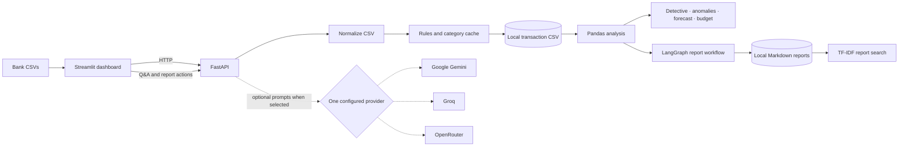
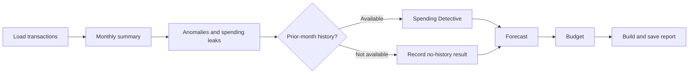

<div align="center">

# SpendSense

### See where your money goes. Understand what changed. Plan your next month.

An AI-assisted personal-finance dashboard for bank CSVs, with explainable analytics, anomaly detection, forecasts, budgets, reports, and grounded Q&A.

[](https://www.python.org/)
[](https://fastapi.tiangolo.com/)
[](https://streamlit.io/)
[](https://langchain-ai.github.io/langgraph/)
[](#llm-providers)
[](#privacy-and-security)
[](.github/workflows/ci.yml)
[](LICENSE)

**[Open the running dashboard](http://127.0.0.1:8504) · [Open the FastAPI docs](http://127.0.0.1:8004/docs)**

<sub>These links are for the developer's laptop only. They are loopback addresses, not a public deployment, and will not open for GitHub visitors.</sub>

</div>

---

## Contents

- [What it does](#what-it-does)
- [Architecture](#architecture)
- [Run locally](#run-locally)
- [LLM providers](#llm-providers)
- [Dashboard](#dashboard)
- [Import format](#import-format)
- [API reference](#api-reference)
- [Docker](#docker)
- [Project structure](#project-structure)
- [Testing and CI](#testing-and-ci)
- [Privacy and security](#privacy-and-security)
- [Limitations](#limitations)
- [Contributing](#contributing)
- [License](#license)

## What it does

SpendSense is a local-first M.Tech Data Science capstone built with Python. Upload bank CSVs and explore monthly finances through a Streamlit dashboard backed by FastAPI.

| Feature | How it works |
|---|---|
| **Transaction import** | Normalizes common bank CSV formats, extracts merchant names, and deduplicates repeat uploads. |
| **Automatic categories** | Ordered merchant rules, a persistent category cache, user corrections, and optional AI classification for unknown merchants. |
| **Monthly overview** | Income, spending, savings rate, investments, category breakdown, and top merchants. |
| **Spending Detective** | Compares a month to up to three prior months and explains changes using transaction-frequency and average-ticket effects. |
| **Unusual spending** | Median/MAD outliers, first-seen merchant checks, duplicate-charge heuristics, and rule-based spending suggestions. |
| **Forecast** | Outlier-damped weighted moving average blended with a linear trend, approximate 80% interval, and rolling-origin backtest MAPE when history allows. |
| **Personalized budget** | Protects essential categories with a buffer and estimates category spending caps for a savings target. |
| **Ask AI** | Answers questions from computed financial facts and relevant retrieved report sections. |
| **Reports and RAG** | LangGraph report workflow, Markdown exports, and local TF-IDF similarity search over reports. |
| **Offline operation** | Deterministic analysis continues to work without an AI provider. |

> **Design principle:** pandas computes the numbers; an optional model explains them. AI-generated text is not a substitute for checking your statement.

## Architecture



The report graph adapts when the user has not uploaded enough history:



## Run locally

The commands below use the currently working ports on this laptop: **API `8004`** and **dashboard `8504`**. Both bind to `127.0.0.1`, so they are not exposed to your network. If those ports are busy on another computer, choose free ports and update `SPENDSENSE_API_URL`.

### 1. Set up Python

Open PowerShell in the project directory:

```powershell
python -m venv .venv
.\.venv\Scripts\Activate.ps1
python -m pip install -r requirements.txt
```

If PowerShell activation is restricted, use the virtual environment directly:

```powershell
.\.venv\Scripts\python.exe -m pip install -r requirements.txt
```

### 2. Configure credentials

Create `.env` only if you do not already have one:

```powershell
if (-not (Test-Path .env)) { Copy-Item .env.example .env }
```

Edit `.env` locally. Never paste keys into source code, screenshots, chat, or commits. To force a local-only run—even if `.env` contains provider keys—set `LLM_PROVIDER=offline` in the API terminal as shown below.

### 3. Generate demo data and run tests

```powershell
python scripts/generate_sample_data.py
python -m pytest -q
```

The generated statements are synthetic examples written to `data/sample/`.

### 4. Start FastAPI

Run this in **Terminal 1**:

```powershell
$env:LLM_PROVIDER = "offline"
python -m uvicorn app.api:app --reload --host 127.0.0.1 --port 8004
```

FastAPI links:

- **Interactive API docs:** <http://127.0.0.1:8004/docs>
- **OpenAPI schema:** <http://127.0.0.1:8004/openapi.json>
- **Health check:** <http://127.0.0.1:8004/health>

### 5. Start Streamlit

Run this in **Terminal 2**:

```powershell
$env:SPENDSENSE_API_URL = "http://127.0.0.1:8004"
python -m streamlit run dashboard/streamlit_app.py --server.address 127.0.0.1 --server.port 8504
```

Open the **[SpendSense dashboard](http://127.0.0.1:8504)**. Stop either process with **Ctrl+C** in its terminal.

### macOS/Linux

Activate the virtual environment with:

```bash
source .venv/bin/activate
```

The `python -m uvicorn` and `python -m streamlit` commands are the same. Set `LLM_PROVIDER=offline` and `SPENDSENSE_API_URL` in the shell using your platform's environment-variable syntax.

## LLM providers

SpendSense supports one explicitly selected provider at a time. `LLM_PROVIDER` chooses which key is used; keys for the other providers are ignored.

| `LLM_PROVIDER` | Environment key | Example `LLM_MODEL` |
|---|---|---|
| `google` | `GOOGLE_API_KEY` | `gemini-2.5-flash` |
| `groq` | `GROQ_API_KEY` | `llama-3.3-70b-versatile` |
| `openrouter` | `OPENROUTER_API_KEY` | `google/gemini-2.5-flash` |
| `auto` | First configured key: Google, then Groq, then OpenRouter | Must match the selected provider |
| `offline` | No key is used | Not applicable |

`LLM_MODEL` must be supported by the selected provider. OpenRouter uses its OpenAI-compatible endpoint and an OpenRouter model identifier; it does not require an OpenAI API key. The safe template is [.env.example](.env.example); `.env` is ignored by Git.

## Dashboard

The seven tabs are:

1. **Overview** — monthly KPIs, spending chart, and top merchants.
2. **Spending Detective** — reasons for spending changes and category drivers.
3. **Unusual & Waste** — flagged transactions and rule-based savings opportunities.
4. **Forecast & Budget** — next-month estimate, interval, backtest result, and adjustable savings goal.
5. **Ask AI** — suggested questions and answers grounded in computed facts.
6. **Reports (RAG)** — generate a report, search previous reports, and download Markdown.
7. **Transactions** — browse transactions and save merchant category corrections.

Use the sidebar to upload CSVs, load demo data, select a month, or clear the local transaction store.

## Import format

The CSV parser recognizes case-insensitive common headers:

| Data | Supported examples |
|---|---|
| Date | `Date`, `Txn Date`, `Transaction Date`, `Value Date`, `Posting Date` |
| Description | `Description`, `Narration`, `Particulars`, `Details`, `Remarks` |
| Debit/credit | `Debit` + `Credit`, `Withdrawal` + `Deposit`, and similar variants |
| Signed amount | `Amount` or `Transaction Amount`; negative means spending and positive means income unless a type column says otherwise |
| Optional transaction type | `Type`, `Dr/Cr`, `Transaction Type` |

Rows without valid dates or positive amounts are discarded. By default, normalized transactions are stored in `data/store/transactions.csv`; set `SPENDSENSE_DATA` to choose another data directory. Re-uploading a statement is deduplicated.

## API reference

FastAPI's `/docs` page includes request schemas and a “Try it out” interface.

| Method | Path | Purpose |
|---|---|---|
| `GET` | `/health` | API and selected-provider status |
| `POST` | `/upload` | Ingest CSV files as multipart form data (`files`) |
| `POST` | `/demo-data` | Ingest bundled synthetic statements |
| `DELETE` | `/data` | Clear the transaction store |
| `GET` | `/months` | List months with data |
| `GET` | `/transactions?month=YYYY-MM` | Read all or month-filtered transactions |
| `GET` | `/categories` | List categories |
| `PUT` | `/categories` | Save merchant category overrides |
| `GET` | `/summary/{month}` | Monthly totals and breakdown |
| `GET` | `/anomalies/{month}` | Anomalies and unnecessary-spend rules |
| `GET` | `/detective/{month}` | Explain changes against history |
| `POST` | `/detective/{month}/narrate` | Optional AI narration |
| `GET` | `/forecast?month=YYYY-MM` | Forecast after a selected month |
| `GET` | `/budget?savings_target=0.2&month=YYYY-MM` | Personalized budget suggestions |
| `POST` | `/report/{month}` | Run and save a monthly report |
| `GET` | `/reports` | List saved report months |
| `GET` | `/reports/search?q=...&limit=4` | Search saved report sections |
| `GET` | `/reports/{month}` | Retrieve a saved report |
| `POST` | `/ask` | Ask a question with `{"question":"..."}` |

Example `PUT /categories` request:

```json
{
  "overrides": {
    "Example Merchant": "Groceries"
  }
}
```

`DELETE /data` removes the configured transaction store. It does not remove sample CSVs or report files.

## Docker

Docker Compose starts FastAPI and Streamlit together, shares a named data volume, waits for the API health check, and publishes both services on localhost:

```powershell
docker compose up --build
```

- Dashboard: <http://127.0.0.1:8501>
- API docs: <http://127.0.0.1:8000/docs>

These are Docker's host ports; they differ from the current local development ports above. If they are occupied, stop the conflicting processes or change the host-side port mappings. `docker compose down --volumes` also deletes the Compose-managed transactions and reports.

## Project structure

```text
spendsense/
├── app/
│   ├── analysis.py       summaries, anomaly checks, spending-leak rules
│   ├── api.py            FastAPI routes
│   ├── budget.py         savings-target budget suggestions
│   ├── categorizer.py    merchant rules, optional AI fallback, overrides
│   ├── config.py         local data paths and category sets
│   ├── detective.py      frequency/ticket decomposition
│   ├── forecast.py       forecast and rolling-origin backtest
│   ├── graph.py          LangGraph report workflow
│   ├── llm_client.py     Gemini, Groq, OpenRouter, offline selection
│   ├── loader.py         bank CSV normalization
│   ├── qa.py             fact-grounded question answering
│   ├── rag.py            local TF-IDF report retrieval
│   ├── report.py         Markdown report builder
│   └── store.py          deduplication and transaction persistence
├── dashboard/
│   ├── api_client.py     HTTP client for the local API
│   └── streamlit_app.py  seven-tab dashboard
├── data/
│   ├── sample/           synthetic example statements
│   ├── reports/          generated Markdown reports
│   └── store/            local transaction data
├── scripts/              demo and sample-data generator
├── tests/                unit, API, workflow, and provider tests
├── .env.example
├── Dockerfile
├── docker-compose.yml
├── LICENSE
├── Makefile
└── requirements.txt
```

## Testing and CI

Run the test suite:

```powershell
python -m pytest -q
```

GitHub Actions in [.github/workflows/ci.yml](.github/workflows/ci.yml) installs dependencies, generates synthetic data, runs tests for pushes and pull requests, then builds the Docker image.

## Privacy and security

- There is no bank-feed integration; the user uploads statements.
- Offline mode stores data locally and performs deterministic analysis without provider calls.
- When enabled, AI requests can include merchant names, transaction descriptions, computed financial facts, or retrieved report excerpts needed for the selected feature. Review your provider's terms before using real statements.
- Local development binds to `127.0.0.1`. Do not expose this unauthenticated, single-user API to a public network.
- Keep `.env` private. Revoke and replace any provider key that is exposed.

## Limitations

- Built for local, single-user educational use; no authentication or multi-user isolation.
- Forecast accuracy is limited when the transaction history is short or irregular.
- Merchant rules may need manual corrections; bank CSV formats vary.
- Anomaly and “unnecessary spending” flags are heuristics, not fraud determinations or financial advice.
- AI output can be inaccurate; verify important figures against the computed values and original statement.

## Contributing

1. Create a focused branch.
2. Make changes with tests or documentation updates as appropriate.
3. Run `python -m pytest -q`.
4. Open a pull request describing the change and verification.

Do not commit `.env`, bank statements, generated personal reports, or credentials.

## License

Distributed under the [MIT License](LICENSE).
